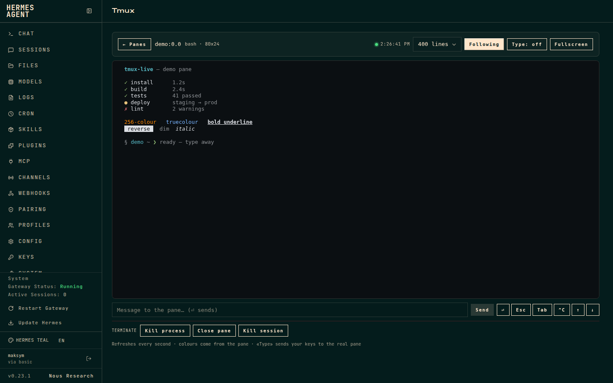
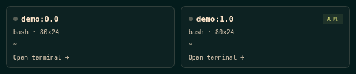

# tmux-live

Una **pestaña tmux en vivo para el dashboard de [Hermes Agent](https://hermes-agent.nousresearch.com)**:
elige un panel, míralo con color real, escribe en él cuando haga falta y ciérralo
cuando termines.

[English](README.md) · MIT · plugin de comunidad, no oficial



## Qué hace

- **Selector de paneles** — una tarjeta por panel (`sesión / ventana / panel`)
  con el comando en ejecución, el tamaño y el directorio de trabajo. La rejilla
  no captura el contenido de los paneles, así que aguanta muchas sesiones.

  
- **Terminal con color** — render ANSI SGR con 16, 256 y truecolor, además de
  negrita, tenue, cursiva, subrayado, reverse y tachado. Sin librerías externas
  ni CDN.
- **Teclado nativo** — haz clic en la terminal (recibe el foco sola) y escribe
  directamente en el panel real. Las teclas viajan por WebSocket y se escriben
  con `tmux send-keys`: texto, ⏎, Backspace, Tab/Shift-Tab, Esc, Delete/Insert,
  Home/End/PageUp/PageDown, F1–F12, flechas y combinaciones con Ctrl. Se puede
  pegar y el socket se reconecta solo.
- **Vista general / administración** — todos los paneles del host agrupados por
  sesión tmux, con contadores de sesiones/paneles/conectados, comando, tamaño y
  directorio. Abre cualquier terminal, cierra un panel o mata una sesión desde
  la vista general. Toda acción destructiva pide confirmación.
- **Scrollback** — 120 / 400 / 800 / 2000 líneas, autoscroll y pantalla completa.
- **Terminar** — matar el proceso en primer plano (`SIGTERM` o `SIGKILL`), cerrar
  el panel o matar la sesión completa. Todo con confirmación.
- **UI bilingüe** — español o inglés según `navigator.language`.

## Requisitos

- Hermes Agent con dashboard web (`hermes dashboard`), v0.23 o superior.
- `tmux` en el mismo host y usuario que el dashboard.

## Instalación

Los plugins de dashboard se instalan por estructura de directorios, no por `pip`:

```bash
git clone https://github.com/maksymhs/hermes-tmux-live.git ~/.hermes/plugins/tmux-live
hermes plugins enable tmux-live
```

Reinicia el dashboard una vez para que monte las rutas de la API (la pestaña se
recoge al recargar):

```bash
systemctl --user restart hermes-dashboard   # o como lo ejecutes
```

Abre el dashboard y aparecerá la pestaña **Tmux** después de *Skills*.

### Desinstalar

```bash
hermes plugins disable tmux-live
rm -rf ~/.hermes/plugins/tmux-live
```

## Cómo funciona

| Método | Ruta | Uso |
| --- | --- | --- |
| GET | `/api/plugins/tmux-live/health` | versión de tmux, socket resuelto, nº de paneles |
| GET | `/api/plugins/tmux-live/panes` | sesiones, ventanas y paneles |
| GET | `/api/plugins/tmux-live/capture?target=sesion:0.0&lines=400&ansi=1` | contenido del panel con escapes ANSI |
| POST | `/api/plugins/tmux-live/send` | `{target, text?}` o `{target, key?}` |
| WS | `/api/plugins/tmux-live/ws?target=sesion:0.0` | entrada directa: `{text}` / `{key}` / `{type: "ping"}` |
| POST | `/api/plugins/tmux-live/kill` | `{target, mode: process\|pane\|session, signal?}` |

El frontend consulta `capture` una vez por segundo mientras hay un panel abierto
y pinta las secuencias SGR él mismo. El teclado usa el WebSocket para ir con
poca latencia; la ruta HTTP `send` sigue disponible para scripts. No se
empaqueta nada: React y los componentes vienen del SDK de plugins del dashboard,
así que el plugin pesa unos pocos KB.

## Seguridad

Este plugin puede escribir y terminar procesos: trata el dashboard como la
superficie sensible que es.

- Todas las llamadas a tmux van por `subprocess` con lista de argumentos; nunca
  hay shell.
- El `target` se valida con `^[A-Za-z0-9_][A-Za-z0-9_.:@%+-]{0,79}$`.
- La escritura se limita a texto literal (sin caracteres de control) o a una
  lista cerrada de teclas. El WebSocket valida su `target` y usa la misma lista;
  no hay endpoint de ejecución de comandos.
- `kill` solo acepta `process` / `pane` / `session` y `TERM` / `KILL` / `INT`.
  El proceso se localiza por `#{pane_pid}` y su grupo en primer plano (`tpgid`
  en `/proc/<pid>/stat`).
- Todas las rutas quedan detrás de la autenticación del dashboard. No expongas
  el dashboard a internet sin ella.

## El detalle de `PrivateTmp`

Un dashboard arrancado por systemd con `PrivateTmp=yes` recibe su propio `/tmp`,
así que no ve `/tmp/tmux-<uid>/default`. El plugin prueba, por orden:
`TMUX_TMPDIR`, `/tmp`, `/proc/<pid>/root/tmp/...` de procesos del mismo usuario,
`/proc/1/root/...` y `$XDG_RUNTIME_DIR`. Cachea el primer socket que tmux acepta
y vuelve a probar si ese proceso desaparece.

Si prefieres la vía simple, quita el tmp privado del servicio:

```bash
sudo systemctl edit hermes-dashboard.service
# [Service]
# PrivateTmp=no
sudo systemctl daemon-reload && sudo systemctl restart hermes-dashboard
```

## Desarrollo

Sin build. Edita `dashboard/dist/index.js` (un IIFE normal) y recarga el
dashboard; `node --check` detecta errores de sintaxis. Tras tocar
`plugin_api.py`, reinicia el dashboard: las rutas se montan al arrancar.

## Limitaciones

- La vista es un **espejo**: la entrada se envía al instante por WebSocket, pero
  la pantalla se refresca cada segundo, así que lo que escribes aparece en la
  siguiente consulta. No es un PTY adjunto.
- Adjuntar un PTY real se evitó a propósito: tmux redimensiona la ventana para
  todos los clientes conectados, lo que cambiaría el layout de la sesión que
  estás mirando.
- Solo se ven los paneles del mismo host y usuario que el dashboard. Para otra
  máquina, ejecuta allí el dashboard o abre una terminal SSH.

## Licencia

MIT — ver [LICENSE](LICENSE).
