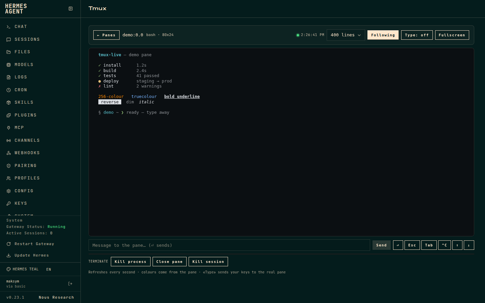
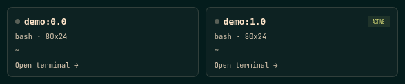

# tmux-live

A **live tmux tab for the [Hermes Agent](https://hermes-agent.nousresearch.com) dashboard**:
pick a pane, watch it in real colour, type into it when you need to, and close
it when you are done.

[Español](README.es.md) · MIT · unofficial community plugin



```
┌ tmux ───────────────────────────────────────────────────────────┐
│ ● 2 live panes                          ● 14:32:07   [Refresh]  │
├─────────────────────────────────────────────────────────────────┤
│ ┌ oceans-api:0.0        [active] ┐  ┌ worker:0.1               ┐ │
│ │ python3 · 120x40               │  │ bash · 80x24             │ │
│ │ ~/projects/oceans-api          │  │ ~/code/worker            │ │
│ │ Open terminal →                │  │ Open terminal →          │ │
│ └────────────────────────────────┘  └──────────────────────────┘ │
└─────────────────────────────────────────────────────────────────┘
```

## Features

- **Pane picker** — one card per tmux pane (session / window / pane) with the
  running command, geometry and working directory. No polling of pane contents
  on the grid, so it stays cheap with many panes.

  
- **Colour terminal** — ANSI SGR rendering with 16, 256 and truecolour support,
  bold / dim / italic / underline / reverse / strikethrough. No external
  terminal library, no CDN.
- **Native keyboard input** — click the terminal (it focuses automatically) and
  type directly into the real pane. Keystrokes travel over a WebSocket and are
  written with `tmux send-keys`: printable text, Enter, Backspace, Tab/Shift-Tab,
  Esc, Delete/Insert, Home/End/PageUp/PageDown, F1–F12, arrows and Ctrl
  combinations. Paste is supported and the socket reconnects on its own.
- **Server overview / management** — the pane picker lists every terminal on the
  host with its command, geometry and working directory. A compact `Manage`
  toggle reveals per-pane close and per-session kill actions. All destructive
  actions ask for confirmation.
- **Scrollback** — 120 / 400 / 800 / 2000 lines, autoscroll toggle, fullscreen.
- **Terminate** — kill the pane's foreground process (`SIGTERM` or `SIGKILL`),
  close the pane, or kill the whole session. Every action asks for confirmation.
- **Bilingual UI** — Spanish or English, chosen from `navigator.language`.

## Requirements

- Hermes Agent with the web dashboard (`hermes dashboard`), v0.23 or newer.
- `tmux` on the same host and user as the dashboard.

## Install

Dashboard plugins are installed by directory layout, not by `pip`:

```bash
git clone https://github.com/maksymhs/hermes-tmux-live.git ~/.hermes/plugins/tmux-live
hermes plugins enable tmux-live
```

Restart the dashboard once so the plugin's API routes are mounted (the JS tab is
picked up on reload):

```bash
systemctl --user restart hermes-dashboard   # or however you run it
```

Open the dashboard and the **Tmux** tab appears after *Skills*.

### Uninstall

```bash
hermes plugins disable tmux-live
rm -rf ~/.hermes/plugins/tmux-live
```

## How it works

The plugin is a single directory with three layers:

```
tmux-live/
├── plugin.yaml                  # Hermes plugin metadata (no tools/hooks)
├── dashboard/
│   ├── manifest.json            # tab registration + API file
│   ├── plugin_api.py            # FastAPI routes, mounted at /api/plugins/tmux-live/
│   └── dist/
│       ├── index.js             # pre-built IIFE, uses window.__HERMES_PLUGIN_SDK__
│       └── style.css
```

| Method | Route | Purpose |
| --- | --- | --- |
| GET | `/api/plugins/tmux-live/health` | tmux version, resolved socket, pane count |
| GET | `/api/plugins/tmux-live/panes` | sessions, windows, panes |
| GET | `/api/plugins/tmux-live/capture?target=session:0.0&lines=400&ansi=1` | pane contents with ANSI escapes |
| POST | `/api/plugins/tmux-live/send` | `{target, text?}` or `{target, key?}` |
| WS | `/api/plugins/tmux-live/ws?target=session:0.0` | input (`{text}` / `{key}`) and live screen frames (`{type: "watch"}`) |
| POST | `/api/plugins/tmux-live/kill` | `{target, mode: process\|pane\|session, signal?}` |

While a pane is open the frontend keeps a WebSocket to the server. The server
captures the pane about eight times a second and pushes a frame only when its
content hash changes; the client renders the SGR sequences itself. The same
socket carries keystrokes. If screen frames stop arriving (for example after a
backend/frontend version mismatch), the client automatically falls back to HTTP
`capture`; the HTTP `capture` / `send` routes also remain available for scripts.
Nothing is bundled: React and the UI primitives come from the dashboard's plugin
SDK, so the whole plugin is a few KB.

## Security

This plugin can type into and terminate processes, so treat the dashboard as the
sensitive surface it is.

- Every tmux call is an argv list through `subprocess` — there is no shell.
- Pane targets are validated with `^[A-Za-z0-9_][A-Za-z0-9_.:@%+-]{0,79}$`.
- Writing is limited to literal text (control characters stripped) or a fixed
  whitelist of key names. The WebSocket validates its target and uses the same
  whitelist; there is no command-execution endpoint.
- `kill` accepts only `process` / `pane` / `session` and `TERM` / `KILL` / `INT`.
  The process is found from `#{pane_pid}` and its foreground process group
  (`tpgid` in `/proc/<pid>/stat`).
- All routes sit behind the dashboard's own auth gate. Do not expose the
  dashboard to the public internet without it.

## The `PrivateTmp` caveat

A dashboard started by systemd with `PrivateTmp=yes` gets its own `/tmp`, so it
cannot see `/tmp/tmux-<uid>/default`. The plugin probes, in order:
`TMUX_TMPDIR`, `/tmp`, `/proc/<pid>/root/tmp/...` for same-user processes,
`/proc/1/root/...` and `$XDG_RUNTIME_DIR`. It caches the first socket tmux
accepts and re-probes if that process disappears.

If you prefer the simple route, drop the private tmp for the service:

```bash
sudo systemctl edit hermes-dashboard.service
# [Service]
# PrivateTmp=no
sudo systemctl daemon-reload && sudo systemctl restart hermes-dashboard
```

## Development

No build step. Edit `dashboard/dist/index.js` (a plain IIFE) and refresh the
dashboard; `node --check` catches syntax errors. After editing
`plugin_api.py`, restart the dashboard — API routes are mounted at startup.

## Limitations

- The view is a **mirror**: input is sent immediately over the WebSocket, but
  the screen is sampled about eight times a second, so it can trail the real
  pane by a frame. It is not a PTY attachment.
- Attaching a real PTY client was deliberately avoided: tmux resizes a window
  for every attached client, which would change the layout of the session you
  are watching.
- Only panes on the same host and user as the dashboard are visible. For a
  remote machine, run the dashboard there or open an SSH terminal.

## License

MIT — see [LICENSE](LICENSE).
